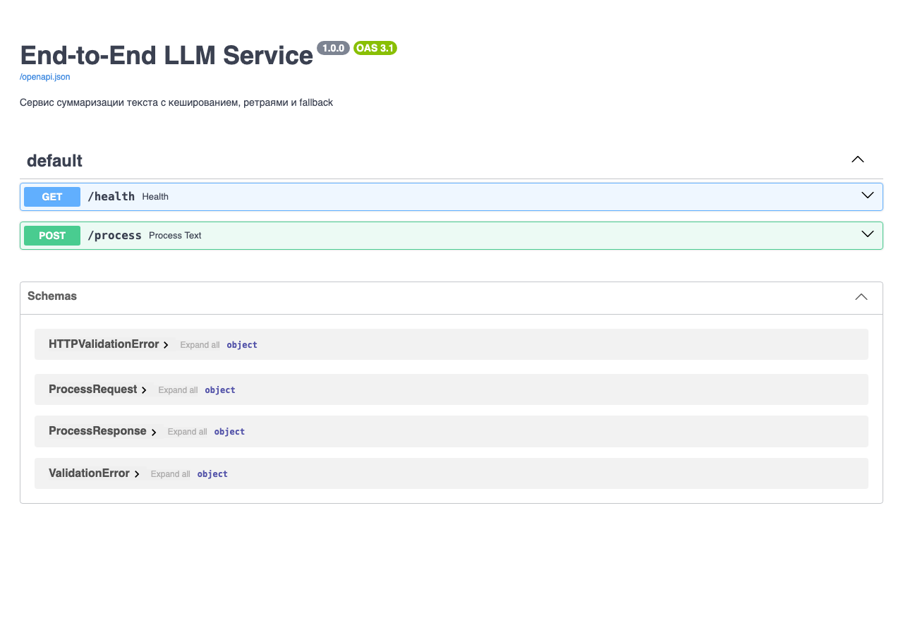
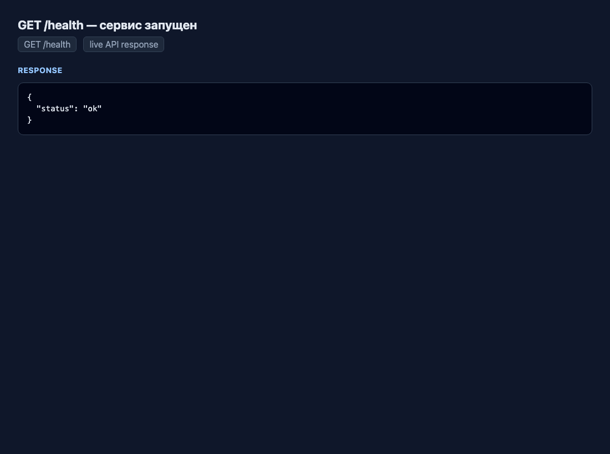
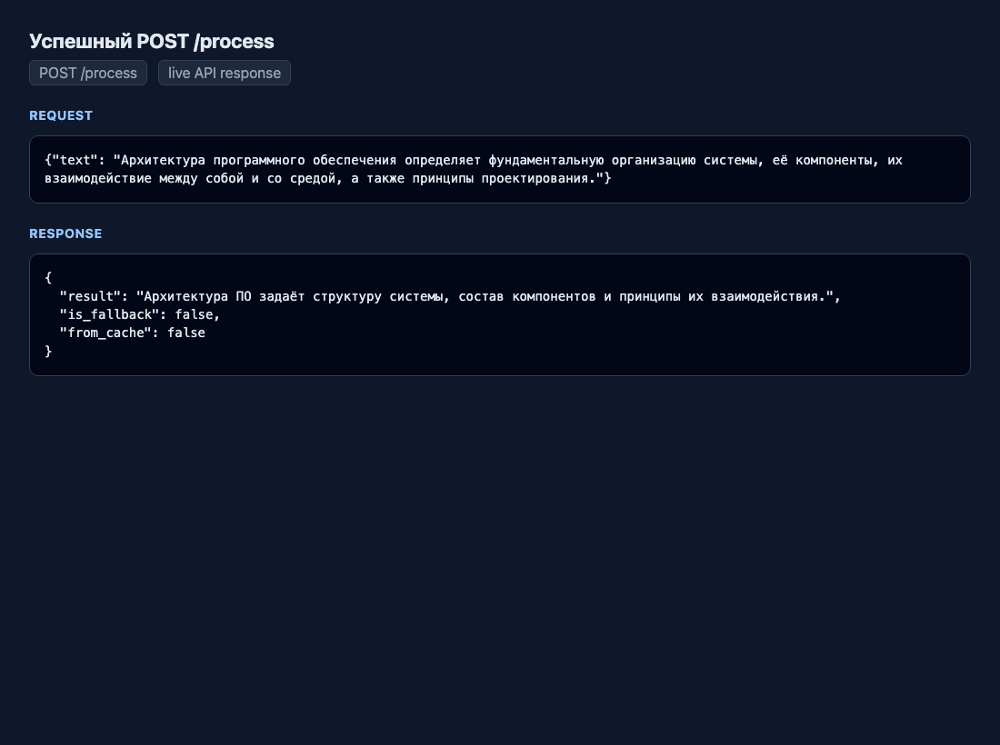
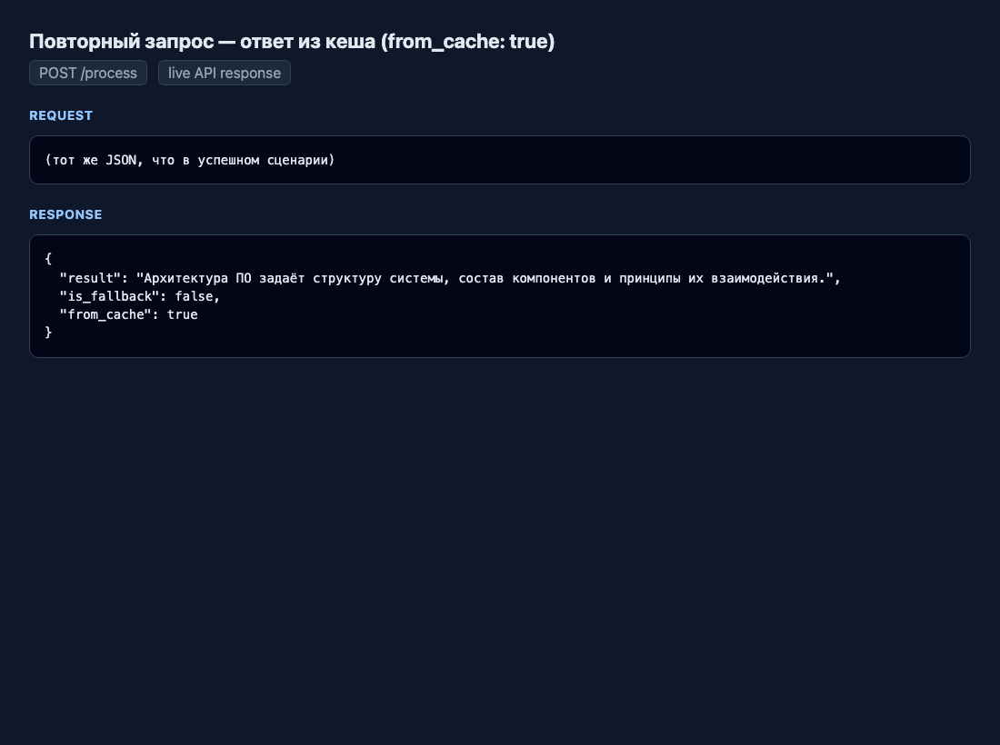
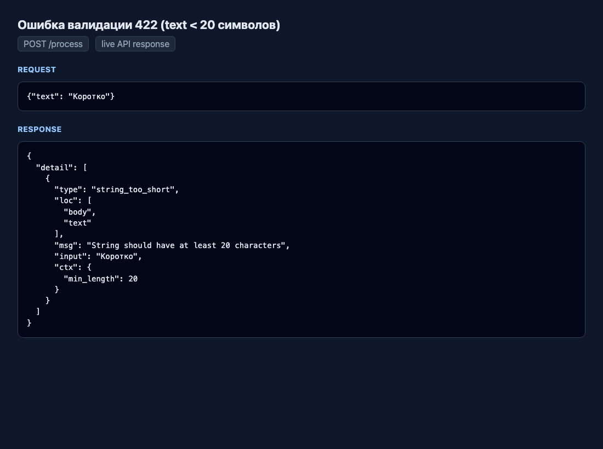
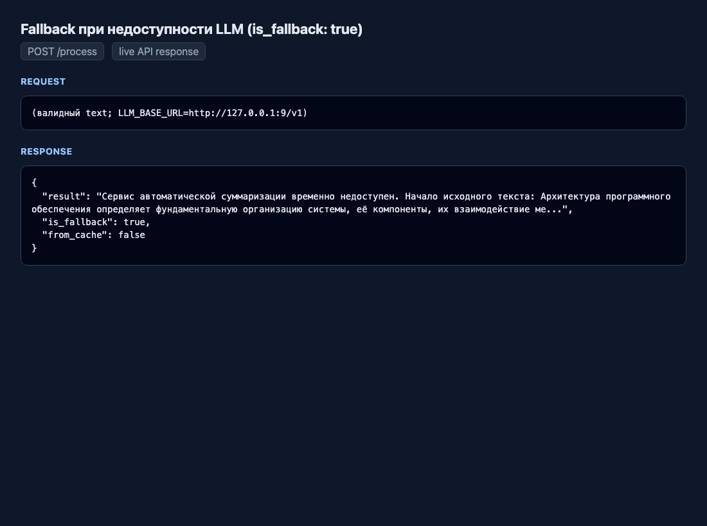

# Отчёт о тестировании

## Автоматические проверки

```bash
ruff check .
pytest -v
```

Ожидаемый результат: линтер без ошибок; все тесты зелёные.

Покрытые сценарии:

| Тест | Что проверяет |
| --- | --- |
| `test_health_check` | `GET /health` → `200` |
| `test_validation_error_on_short_text` | короткий `text` → `422` |
| `test_validation_error_on_missing_text` | пустое тело → `422` |
| `test_pipeline_success_and_cache_hit` | успех + повтор из кеша без второго вызова LLM |
| `test_cache_key_depends_on_model_and_temperature` | корректность ключа кеша |
| `test_cache_expiry` | TTL → miss после истечения |
| `test_pipeline_fallback_on_network_error` | `LLMNetworkError` → fallback |
| `test_llm_client_retries_then_raises` | ретраи при сетевой ошибке |

## Демонстрация (скриншоты)

Скриншоты сняты с локально запущенного сервиса (`uvicorn main:app`, `http://127.0.0.1:8000`).

### 1. Запуск сервиса — Swagger UI



### 2. Healthcheck



### 3. Успешный запрос



`is_fallback: false`, `from_cache: false`, возвращена краткая выжимка.

### 4. Повторный запрос — кеш



Тот же текст → `from_cache: true` без повторного вызова LLM.

### 5. Ошибка валидации



`{"text": "Коротко"}` → HTTP `422`, `string_too_short`.

### 6. Fallback при недоступности LLM



Недоступный `LLM_BASE_URL` → ретраи, затем `200` с `is_fallback: true`.

## Ручные сценарии (`POST /process`)

### 1. Корректный запрос → успешный ответ

- Действие: валидный текст (> 20 символов) при рабочем LLM.
- Ожидание: `200`, `is_fallback=false`, `from_cache=false`.
- Логи: `Incoming POST /process` → `Cache MISS` → `Prompt constructed` → `LLM request attempt` → `LLM response received` → `Cache SET`.

### 2. Повторный запрос → ответ из кеша

- Действие: тот же JSON в пределах `CACHE_TTL_SECONDS`.
- Ожидание: быстрый `200`, `from_cache=true`.
- Логи: `Incoming POST /process` → `Cache HIT`.

### 3. Некорректный ввод → понятная ошибка

- Действие: `{"text": "Коротко"}`.
- Ожидание: `422` с описанием `string_too_short`.

### 4. Сбой внешнего вызова → ретраи и fallback

- Действие: `LLM_BASE_URL=http://127.0.0.1:9/v1` и новый текст.
- Ожидание: попытки в логах, затем `200` с `is_fallback=true`.
